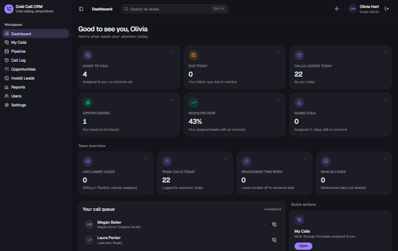
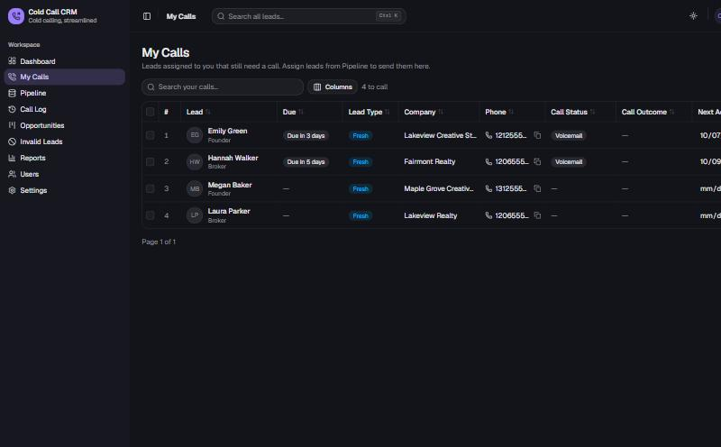
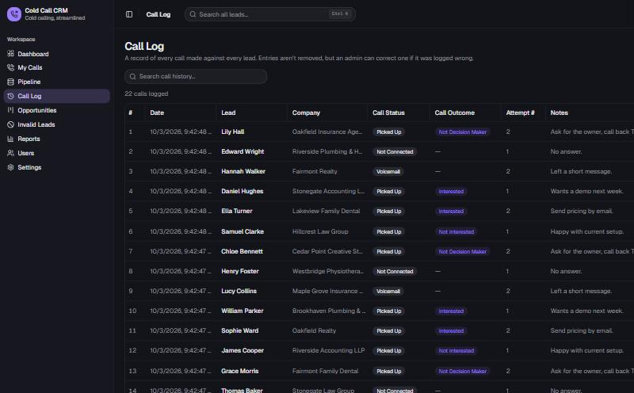
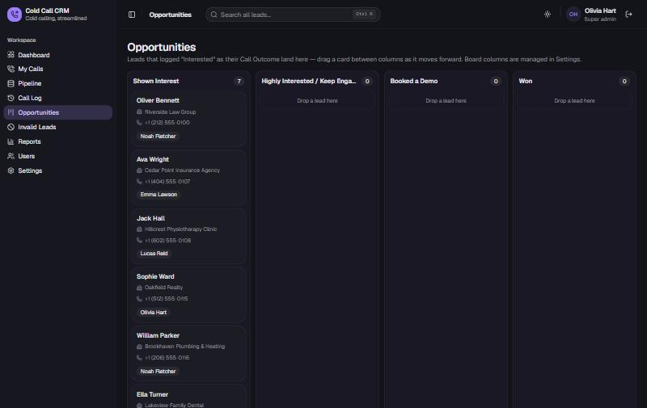

# Cold Call CRM

A lightweight CRM for outbound calling teams. Import a lead list, hand leads out to callers, log every call, and move interested prospects across an opportunities board — without the weight of a full sales platform.

Built with Next.js, Postgres (Supabase works out of the box) and deploys to Vercel in a few minutes.



## What it does

| Area | What you get |
|---|---|
| **Pipeline** | Import CSV or Excel files. Columns are matched automatically, duplicates are skipped, and every import can be undone. |
| **My Calls** | Each caller's personal queue with due dates, follow-ups and one-click phone links. |
| **Call Log** | A permanent record of every call: status, outcome, attempt number, notes and next action. |
| **Opportunities** | Leads marked *Interested* land on a drag-and-drop board with stages you define. |
| **Invalid Leads** | Bad numbers and wrong-fit leads are set aside, not deleted, so they can be reused later. |
| **Reports** | Calls per day, reach rate and outcomes, filterable by date, caller, industry and source. |
| **Scripts & emails** | Generate a call script or cold email for any lead from your own templates — or with OpenAI if you add a key. |
| **Team & backups** | Admin and rep roles, per-user permissions, and automatic daily backups with one-click restore. |

| My Calls | Call Log | Opportunities |
|---|---|---|
|  |  |  |

## Quick start

You need **Node.js 20+** and a **Postgres database**. A free [Supabase](https://supabase.com) project is the easiest option.

```bash
git clone https://github.com/ansab-imam/cold-call-crm.git
cd cold-call-crm
npm install
cp .env.example .env.local     # then fill in the values (see below)
npm run db:setup               # creates the one table the app needs
npm run dev
```

Open <http://localhost:3000> and sign in with the `INITIAL_ADMIN_EMAIL` and `INITIAL_ADMIN_PASSWORD` you set.

### Getting a database URL from Supabase

1. Create a project at [supabase.com](https://supabase.com).
2. Click **Connect** at the top of the project page.
3. Copy the **Transaction pooler** connection string and replace `[YOUR-PASSWORD]` with your database password.
4. Paste it as `DATABASE_URL` in `.env.local`.

Prefer not to use the command line for the table? Paste [`db/schema.sql`](db/schema.sql) into Supabase's **SQL Editor** and click **Run** instead of `npm run db:setup`.

## Configuration

All settings live in environment variables. Copy [`.env.example`](.env.example) to `.env.local` for local use, or add them under **Settings → Environment Variables** in Vercel.

| Variable | Required | Purpose |
|---|---|---|
| `DATABASE_URL` | Yes | Postgres connection string. |
| `AUTH_SECRET` | Yes | Random string used to sign login sessions. Generate one with `node -e "console.log(require('crypto').randomBytes(32).toString('hex'))"`. |
| `INITIAL_ADMIN_EMAIL` | Yes | Email for the first admin account, created automatically on first run. |
| `INITIAL_ADMIN_PASSWORD` | Yes | Password for that account. Change it in the app afterwards. |
| `INITIAL_ADMIN_NAME` | No | Display name for the first admin. |
| `CRON_SECRET` | No | Protects the nightly backup endpoint. Vercel sends it automatically. |
| `OPENAI_API_KEY` | No | Turns on AI-written scripts and emails. Without it, templates are filled in with the lead's details. |
| `OPENAI_MODEL` | No | Defaults to `gpt-4o-mini`. |

## How to use it

1. **Import leads.** Go to **Pipeline → Import** and upload a spreadsheet. Try [`sample-data/sample-leads.csv`](sample-data/sample-leads.csv) (30 made-up leads) or click **Download sample** for a blank template with the expected columns.
2. **Add your team.** Under **Users**, create an account for each caller.
3. **Assign leads.** Select rows in Pipeline and assign them. They move into that person's **My Calls** queue.
4. **Make calls.** Open a lead, click the phone number to dial, then **Log call** with the status, outcome, notes and next follow-up date.
5. **Work opportunities.** Any lead logged as *Interested* appears on **Opportunities**. Drag cards between stages as deals progress.
6. **Review results.** **Reports** shows activity and conversion for any date range or caller.
7. **Make it yours.** **Settings** lets you rename call statuses, outcomes and board stages, edit script and email templates, and download or restore backups.

### Template placeholders

Script and email templates can include lead details using `{{placeholder}}`, with an optional fallback after a `|`:

```text
Hi {{firstName|there}}, I saw that {{companyName}} is based in {{city}}...
```

The full list is shown under **Available placeholders** on the Settings page.

## Deploying to Vercel

1. Push your copy of the repository to GitHub.
2. In Vercel, click **Add New → Project** and import it.
3. Add the environment variables from the table above.
4. Deploy. [`vercel.json`](vercel.json) schedules a daily backup at 04:00 UTC.

## Project structure

```text
src/
  app/(app)/        Pages: dashboard, pipeline, my-calls, call-log, opportunities, reports, users, settings
  app/api/          Route handlers for leads, imports, calls, users, settings and backups
  components/       UI components (shadcn/ui based)
  lib/auth/         Sessions, password hashing, rate limiting, permissions
  lib/pipeline/     Lead schema, import/mapping logic, stores, reports
  lib/db.ts         Postgres connection and the key-value store helpers
db/schema.sql       Database table definition
sample-data/        Example lead file with fictional data
```

Data is stored as JSON documents in a single `app_data` table, which keeps setup to one table and makes full backups and restores a single transaction.

## Scripts

| Command | What it does |
|---|---|
| `npm run dev` | Start the development server |
| `npm run build` | Production build |
| `npm start` | Run the production build |
| `npm run lint` | Lint the code |
| `npm run db:setup` | Create the database table |

## License

[MIT](LICENSE) © 2026 Socialist Fox
